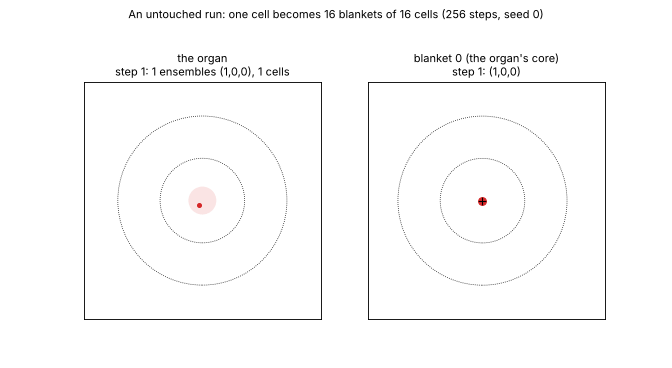
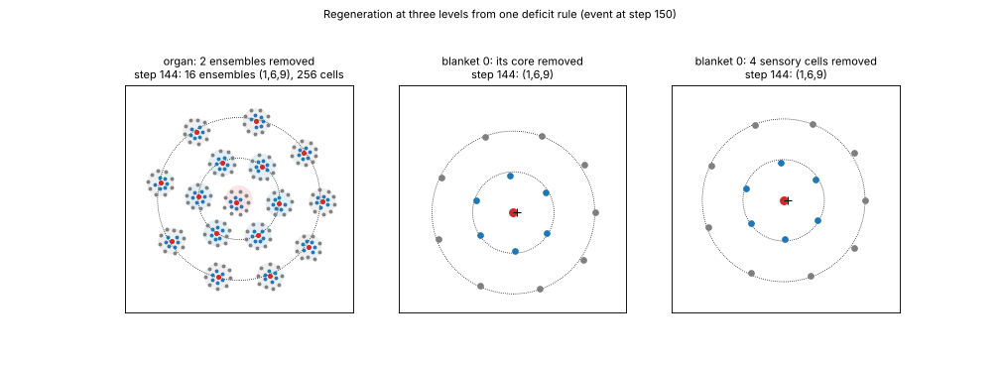

# Embryogenesis: a Markov-blanket organ that grows from one cell and repairs itself

A Python port of the hierarchical self-organisation model of Palacios, Razi, Parr, Kirchhoff
and Friston (2020), extended so that the organ *grows*: one cell becomes a blanket of 16, the
blanket's whole bears 15 more, and the organ of 16 blankets (256 cells) holds its form by
regenerating what it loses and replacing what it cannot correct.  The project started with
Hofstadter's *Gödel, Escher, Bach*: I wanted to build a self-referencing, cross-level strange
loop, a whole whose identity is made of its parts' beliefs about it, and whose beliefs about
itself reach back down into those parts.  The paper's Markov blankets gave the levels; the
loop is what the extensions add.

## The model in five lines

- Every agent (cell, blanket, organ) runs the same step: an action-driven DEM (dynamic
  expectation maximisation) descent on one free energy, the paper's ADEM, ported in `spm.py`.
- A cell's kind (internal, active, sensory) is a belief, read off the signalling field it
  senses each step; the field is produced by every cell's secreted belief (`Gg`, `Mg`).
- A blanket's emission into the organ is a head count of its cells (one unit per cell / 16);
  short of its unit for 3 steps it bears one daughter, of the kind it lacks, on a circle at
  1.3 from its core.  The organ counts its ensembles the same way, one level up.
- Each cell is drawn 5 % of the way per step toward the radius of the kind it currently reads
  itself to be (1 active, 2 sensory); so identity drives position and position confirms identity.
- Turnover: a complete blanket with too many of one kind sheds its least integrated cell of
  that kind, and the next birth replaces it.

What is given from above: the target (1, 6, 9), the two radii, and the turnover and pull rules
(applied between steps, not gradients of the free energy).  Everything else is the descent.
`helpful_diagrams/` draws the generative process `Gg`, the generative model `Mg`, and the loop
between a blanket and its cells.

## Files

| file | what |
|---|---|
| `model.py` | the model: layout, process `Gg`, model `Mg`, restriction, `Fixed`, the ADEM step, `run(seed, nY, ...)` |
| `spm.py` | the seven SPM primitives the step needs |
| `run.py` | run seeds in parallel (one JSON per run, every step traced); report |
| `fig.py` | the suite figure and the recovery table |
| `gif.py` | GIFs of blanket 0 or the whole organ |
| `run_suite.sh` | the 12-configuration suite, then figure and GIFs |
| `check_same.py` | are two run JSONs the same run, to the last bit? |
| `figures_and_animations/` | `animations/`: the untouched run and the five tests below; `graphs/`: the suite figures |
| `helpful_diagrams/` | `Gg`, `Mg` and the blanket-cell loop, drawn |

Requirements: numpy, scipy, matplotlib (Pillow for the GIFs).  One run at 256 steps takes
~28 min and ~17 GB.

## Running

    python3 run.py run --name base --seeds 0-4 --cores 3 --out results
    python3 run.py run --name abl_core --ablate-at 150 --ablate-what core --seeds 0-4 --cores 3 --out results
    python3 run.py report --out results
    python3 fig.py --out results                 # results/suite.png, results/suite_recovery.txt
    python3 gif.py --suite results               # results/gifs/*.gif
    python3 gif.py results/abl_core_s0.json --from 144 --out core.gif --title "the core removed at 150"

Perturbations, all on blanket 0 (the blanket under the organ's core): `--ablate-at STEP
--ablate-what core|sensory|active|random --ablate-n N` removes cells; `--organ-ablate-at STEP
--organ-ablate-n N` removes whole ensembles with their cells; `--mutate-at STEP --mutate-n N
--mutate-what flip|hold` flips N ring cells' kind belief, once or held by a prior for life;
`--wall-at STEP --wall-until STEP` raises a signalling wall through the organ's core (no signal
crosses it; cells still move).  `run_suite.sh` is the full set.

## What the suite found (5 seeds each, 256 steps)

Every one of the 100 runs ended with the organ at (1, 6, 9) in 16 ensembles.  For the blanket
each event hit:

| event | outcome | animation |
|---|---|---|
| 3 cells' kind belief flipped | corrected within the step | `flip_corrected.gif` |
| 3 cells' kind held (a mutation the cell cannot shed) | the misfits removed by turnover and replaced, (1,6,9) in 5 of 5 by step 156-181 | `mutation_repaired.gif` |
| 4 sensory cells removed | regrown in 13 steps, the holes filled | `regeneration_three_levels.gif` |
| the core removed | 3 steps without one; an inner cell bears a new core, the ring re-forms around it | `regeneration_three_levels.gif`, `regeneration_young_vs_formed.gif` |
| 2 ensembles removed | regrown: 16 ensembles in 8 steps, 256 cells in ~60 | `regeneration_three_levels.gif` |
| a signalling wall through the core, 20-100 / 60-140 / 150-200 | inner cells drift out and relabel while it stands; turnover repairs the mix, during the wall and after | `wall_healed.gif` |
| the same events at step 60, during growth | regeneration faster (a lost core resettles in 13 steps against 50) | `regeneration_young_vs_formed.gif` |

Repair has three timescales: identity in a step, composition in tens of steps, geometry in
hundreds.  The one residue is the regrown core: the ring re-centres on it rather than it on the
ring, and the ring stays uneven for the rest of a 512-step run.

The graphs in `figures_and_animations/graphs/`: `suite_*.png` are `fig.py`'s figure for the
formed organ, the events during growth and the repair, everything under turnover, and a
512-step run (each panel the mean over seeds with the min-max band; dotted the event, dashed a
wall up and down); `scars_without_and_with_turnover.png` and `regeneration_three_levels.png`
are drawn from the same traces.

## Reproducibility

Runs are deterministic: every random draw comes from the seed.  `check_same.py a.json b.json
[--prefix]` compares two runs trajectory by trajectory with no tolerance.  This folder was cut
from a larger research code base and checked against its traces: six runs covering every
perturbation, each run past its event, matched in every trajectory, event and birth.  Across
machines the free energy's running sum differs in its 13th digit (BLAS kernels differ); the
rounded trajectories still match.

## Reference

Palacios, E. R., Razi, A., Parr, T., Kirchhoff, M., & Friston, K. (2020). On Markov blankets
and hierarchical self-organisation. *Journal of Theoretical Biology*, 486, 110089.
